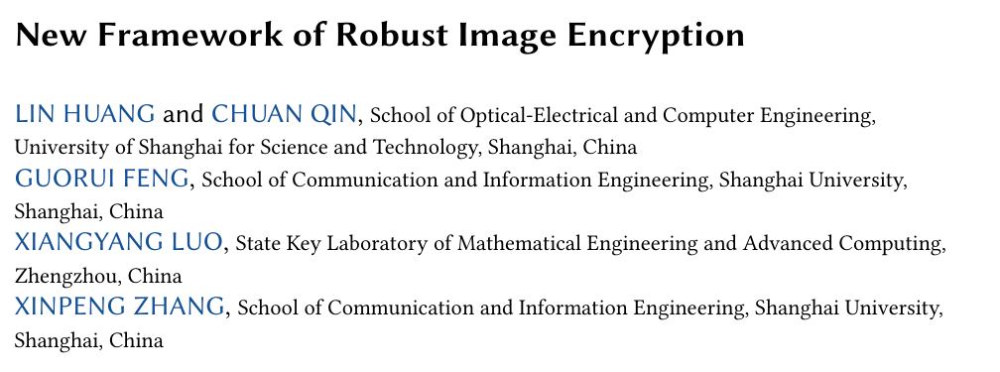

# New Framework of Robust Image Encryption



**Lin Huang, Chuan Qin, Guorui Feng, Xiangyang Luo, and Xinpeng Zhang**  
*ACM Transactions on Multimedia Computing, Communications, and Applications*, 21(3), Article 91, 2025.  
[Paper](https://doi.org/10.1145/3712601)

## Overview

This framework encrypts an image by embedding the plaintext into a noise image derived from a key. An invertible neural network shares parameters between encryption and decryption. The training pipeline incorporates image degradations to improve recovery after common image-processing operations.

## Code

| Entry point | Purpose |
| --- | --- |
| [`train.py`](train_code/train.py) | Train the invertible image encryption model. |
| [`config.py`](train_code/config.py) | Set training paths, model outputs, and noise settings. |
| [`Image_encryption_and_decryption.py`](train_code/Image_encryption_and_decryption.py) | Run the image encryption and decryption evaluation. |
| [`Robustness_analysis.py`](train_code/Robustness_analysis.py) | Evaluate image recovery after selected distortions. |
| [`Security_analysis.py`](train_code/Security_analysis.py) | Calculate image-encryption analysis statistics. |

## Quick start

Prepare a COCO ImageFolder and an INL checkpoint using the [experiment setup](docs/EXPERIMENTS.md). The evaluation writes an image panel and reports PSNR and SSIM.

```bash
python -m pip install -r requirements.txt
cd train_code
python Image_encryption_and_decryption.py --limit 1
```

Run `python train.py` after preparing the train and validation folders to train a new INL checkpoint.

## Citation

Lin Huang, Chuan Qin, Guorui Feng, Xiangyang Luo, and Xinpeng Zhang. “New Framework of Robust Image Encryption.” *ACM Transactions on Multimedia Computing, Communications, and Applications*, 21(3), Article 91, 2025. [DOI](https://doi.org/10.1145/3712601)
